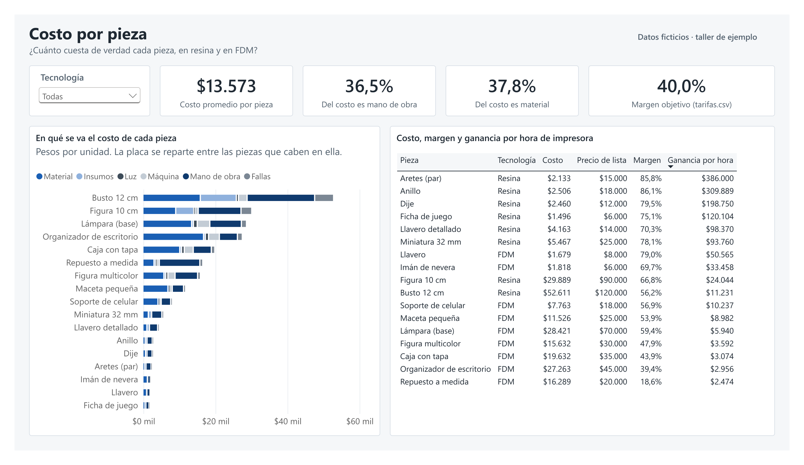
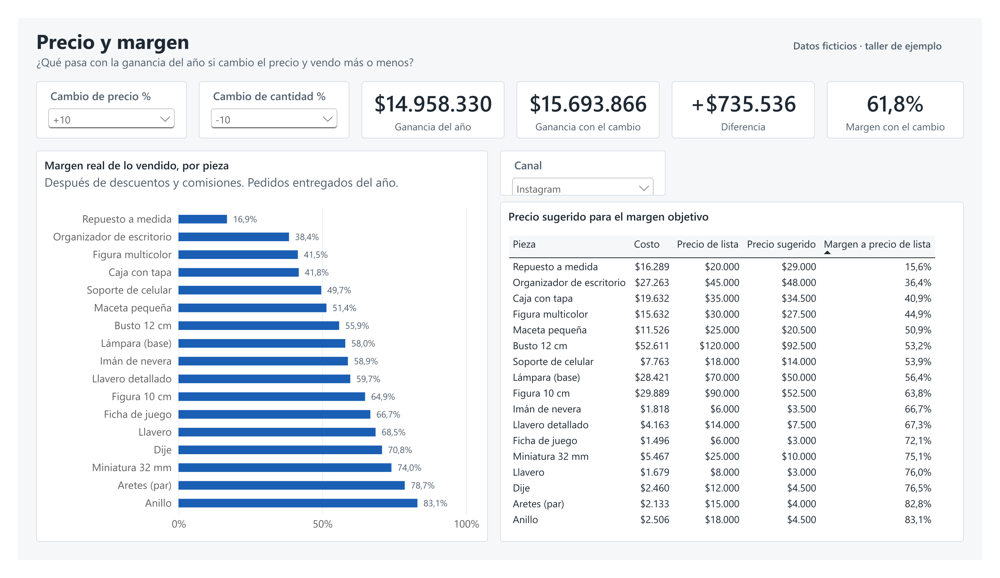
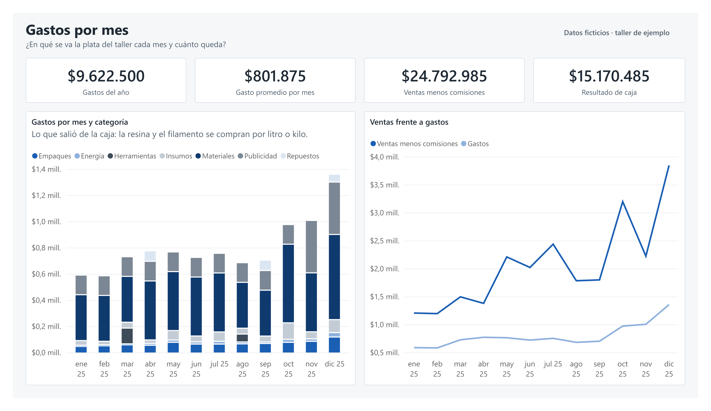
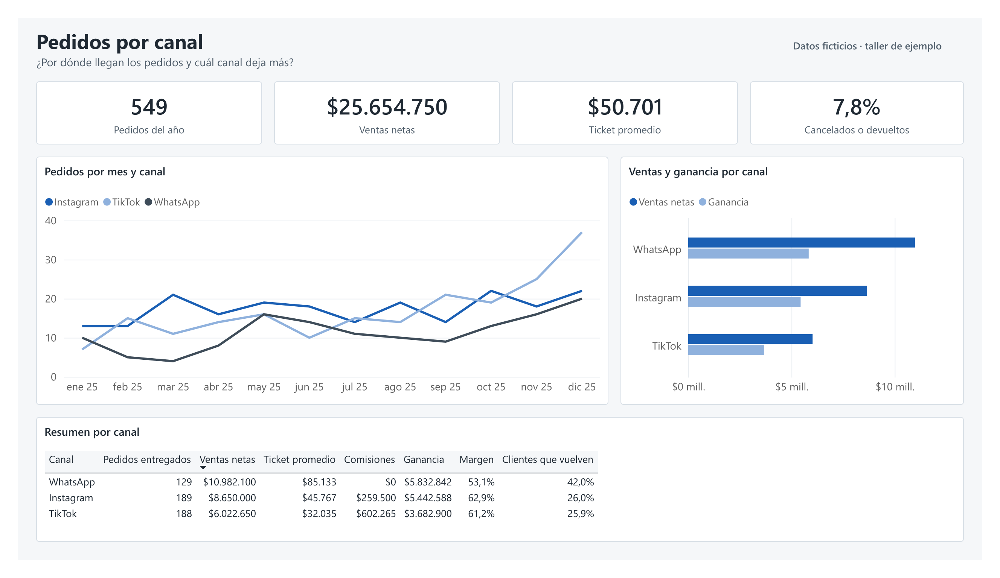
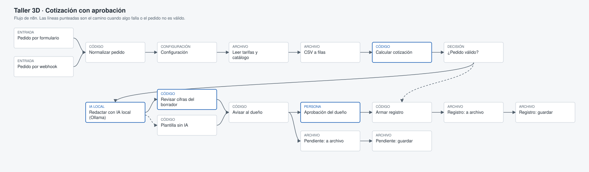

# Taller de impresión 3D: costos y cotizaciones

[English version below](#english)


Tengo un taller de impresión 3D, con una impresora de resina y una FDM. Cuando alguien me pedía una cotización, el precio salía más de memoria que de cuentas. Por eso armé este método: cuánto cuesta de verdad cada pieza, a qué precio venderla para ganar lo que quiero, y cómo responder una cotización rápido sin equivocarme.

> **Todos los datos de este repo son ficticios.** Es la plantilla pública del método, con un taller inventado: tarifas redondas, catálogo, pedidos y gastos hechos por un script. Los datos reales de mi taller se quedan en mi PC y nunca se suben (ver [Privacidad](#privacidad)).

## Qué pregunta responde
1. ¿Cuánto cuesta de verdad cada pieza, en resina y en FDM? No solo el material: también los insumos, la luz, el desgaste de la máquina, mi tiempo y las placas que salen mal.
2. ¿A qué precio la vendo para ganar el margen que quiero, después de la comisión de cada canal?
3. ¿Qué pasa con la ganancia si subo o bajo el precio y vendo más o menos?
4. ¿En qué se va la plata cada mes y por qué canal llegan los pedidos que más dejan?

## Qué hay adentro
| Parte | Qué hace | Dónde |
|---|---|---|
| Datos ficticios | Un taller inventado: 17 piezas, 549 pedidos de 2025, 77 gastos, 320 clientes (solo un código y una ciudad) | `scripts/generar_datos_ficticios.py` → `datos/` |
| Fórmula de costo | El costo de una pieza, paso a paso. Es la referencia de todo lo demás | `scripts/costeo.py` |
| SQL | 9 consultas numeradas y comentadas (SQLite), con funciones de ventana | `sql/` · resultados en `docs/resultados_sql.md` |
| Tablero de Power BI | 4 páginas: costo por pieza, precio y margen con «qué pasa si», gastos por mes y pedidos por canal | `powerbi/` · medidas en `dax/medidas.md` |
| Flujo de n8n | Cotización: recibe el pedido, calcula el precio, la IA local redacta la respuesta, yo apruebo o corrijo y queda registrado | `flujos/` |
| Pruebas | 61 pruebas que corren en GitHub en cada cambio | `pruebas/` · `.github/workflows/pruebas.yml` |

## Cómo se calcula el costo
Una placa de impresión se reparte entre las piezas que caben en ella. En resina eso pesa mucho: una placa llena tarda casi lo mismo que una sola pieza, porque el tiempo depende de la altura.

- **Material:** ml de resina (más lo que se va en soportes) o gramos de filamento (más la purga al cambiar de color).
- **Insumos por placa:** alcohol, guantes, papel y el desgaste del film FEP en resina; pegante en FDM. Se dividen por las piezas de la placa.
- **Luz y máquina:** horas de la placa por consumo y por desgaste de la impresora, divididas por las piezas.
- **Mano de obra:** preparar la placa (repartido) más el acabado de cada pieza.
- **Fallas:** se suma lo que se pierde por placas que salen mal (10 % en resina, 5 % en FDM en el taller de ejemplo).

**Precio sugerido** = costo / (1 − margen objetivo − comisión del canal), redondeado hacia arriba de 500 en 500.

La misma fórmula está en cuatro lugares: Python, SQL, Power Query (el tablero) y JavaScript (el flujo de n8n). Las pruebas comprueban que las cuatro den el mismo número, peso por peso. Así el precio que cotiza n8n es el mismo que muestra el tablero.

## Capturas
Del tablero con los datos ficticios. El PDF completo está en `powerbi/taller3d-costos.pdf`.

| Costo por pieza | Precio y margen |
|---|---|
|  |  |
| **Gastos por mes** | **Pedidos por canal** |
|  |  |

## Qué encontré (en el taller de ejemplo)
Las cifras son del taller ficticio, pero el método es el que uso con el mío. Todas salen de las consultas de `sql/` y cuadran con el tablero.

1. **En resina, lo que más cuesta es el trabajo, no la resina.** La mano de obra es el 40,9 % del costo de las piezas de resina y el material solo el 27,5 %. En FDM es al revés: el filamento es el 46,1 %. Por eso en resina conviene llenar la placa: el tiempo de preparar y lavar se reparte entre más piezas.
2. **El repuesto a medida casi no deja.** A precio de lista gana 18,8 %, y por TikTok, con la comisión, baja a 8,8 %. Fue de lo más vendido (64 unidades). Para ganar el 40 % tendría que costar $27.500 por WhatsApp y no $20.000.
3. **WhatsApp tiene el margen más bajo, pero es el canal que más deja.** Trae el 42,8 % de las ventas con solo 136 de 549 pedidos, ticket promedio de $85.133 y el 42 % de sus clientes vuelve a comprar. Su margen es el más bajo (53,4 %) porque ahí se venden las piezas grandes y a medida, no por comisiones.
4. **Subir el precio 10 % deja más plata aunque se venda 10 % menos.** La ganancia del año pasaría de $15.012.331 a $15.742.466 (+$730.136). Bajar el precio 10 % y vender 20 % más deja casi lo mismo que hoy ($15.039.639), con 20 % más de trabajo.
5. **Lo que importa es cuánto deja cada hora de impresora, no la ganancia por pieza.** La impresora es el cuello de botella: mientras imprime una cosa, no imprime otra. Un par de aretes de resina deja $386.640 por hora de impresora, porque caben 30 en una placa. El organizador de escritorio deja más por pieza ($17.805), pero ocupa la FDM 6 horas: $2.968 por hora. En cambio, la luz casi no pesa: es el 2,1 % de los gastos del año.

## Cómo correrlo
Necesitas Python 3.12 y, para el flujo, Node.js. No hay que instalar paquetes de Python: todo usa la librería estándar.

```bash
python scripts/generar_datos_ficticios.py      # arma el taller inventado en datos/
python scripts/costeo.py                        # costo de cada pieza
python scripts/cargar_sqlite.py                 # corre las 9 consultas SQL
python -m unittest discover -s pruebas -t pruebas -v   # las pruebas
```

**Tablero:** abre `powerbi/taller3d-costos.pbix` en Power BI Desktop. Si clonaste el repo en otra carpeta, cambia el parámetro `CarpetaDatos` (Inicio → Transformar datos → Editar parámetros) a la ruta de tu carpeta `datos\` y dale Actualizar. La fuente del tablero también está en texto en `powerbi/proyecto/` (formato PBIP: modelo en TMDL y páginas en PBIR); `scripts/armar_powerbi.py` la genera.

**Flujo de n8n:**
- Sin Docker, en Windows: `powershell -ExecutionPolicy Bypass -File scripts\iniciar_n8n.ps1` (puerto 5679).
- Con Docker: copia `.env.example` a `.env`, pon una contraseña y corre `docker compose up -d` (n8n + Postgres, puerto 5679).
- Importa `flujos/aviso_errores.json` y después `flujos/cotizacion.json`.
- La IA es local: [Ollama](https://ollama.com) con `qwen3.5:4b`. Si Ollama no responde, el flujo sigue con una plantilla fija y lo anota.

## El flujo de cotización


1. Llega un pedido por el formulario de n8n (o por un webhook, para conectar un bot después).
2. n8n lee `tarifas.csv`, `piezas.csv` y `canales.csv` (los mismos del tablero) y calcula el precio con `flujos/costeo.js`. Si el pedido no tiene sentido (cantidad cero, una pieza que no existe), no pasa a la IA y queda registrado como inválido.
3. La IA local redacta la respuesta con las cifras exactas que le paso.
4. Un control revisa que cada número del borrador esté en la cotización. Si la IA inventa un envío o un descuento, se descarta y se usa la plantilla.
5. Yo apruebo, corrijo o rechazo en un formulario. Si nadie responde en 24 horas, queda como «sin respuesta».
6. Todo queda en `registro/cotizaciones.csv`: costo, precio, margen, si la IA pasó el control y mi decisión. Si algo falla, el flujo de errores lo anota en `registro/errores.csv`.

Reintentos: la llamada a Ollama y la escritura de archivos se reintentan 3 veces antes de fallar.

## Privacidad
- `datos_reales/`, `registro/` y `.env` están en `.gitignore`.
- Cada fila de cada CSV del repo dice `origen_datos = ficticio`. Una prueba falla si aparece un CSV sin esa marca o cualquier archivo dentro de `datos_reales/`.
- Otra prueba busca teléfonos, correos, claves, tokens, IPs de la casa y rutas personales en todos los archivos del repo.
- El tablero muestra en cada página si está leyendo datos ficticios o reales. El `.pbix`, el PDF y las capturas del repo salen de la versión ficticia.
- Los flujos de n8n no traen credenciales. Si conectas Telegram o correo, la credencial se guarda dentro de n8n, nunca en el repo.
- Antes de subir algo, en mi PC corro `python scripts/revisar_privacidad.py`: compara `datos_reales/` contra todo lo que se subiría (incluido el `.pbix`) y avisa si aparece una pieza, un cliente o una tarifa real.

Para usar tus propios datos: copia la carpeta `datos/` como `datos_reales/`, cambia los valores y pon `real` en `origen_datos`. Si los editas en Excel, corre `python scripts/revisar_datos.py --datos datos_reales --arreglar`: Excel en español guarda con punto y coma, coma decimal y fechas dd/mm/aaaa, y el script los deja en el formato que esperan el tablero, el SQL y n8n (antes guarda una copia de los originales). También avisa si falta una tarifa, si un margen quedó escrito como 40 en vez de 0,4 o si un pedido tiene un canal que no existe. Después apunta `CarpetaDatos` del tablero a esa carpeta, o corre los scripts con `--datos datos_reales`.

## Qué falta
- El flujo no le contesta solo al cliente: deja el mensaje aprobado listo para copiar. Conectar WhatsApp o Telegram necesita credenciales que no van en un repo público.
- La demanda del «qué pasa si» la elijo yo con un parámetro. No hay un modelo de cómo cambian las ventas con el precio.
- El costo de la mano de obra usa una tarifa por hora fija. En mi taller real todavía estoy midiendo cuánto tardo de verdad en lavar, curar y quitar soportes.

## Cómo explicarlo en 2 minutos
«Tengo un taller de impresión 3D y me di cuenta de que cotizaba de memoria. Entonces armé un método para saber cuánto cuesta de verdad cada pieza: el material, pero también los insumos, la luz, el desgaste de la impresora, mi tiempo y las placas que salen mal. La clave es que una placa se reparte entre todas las piezas que caben en ella.

Con eso hice un tablero en Power BI de cuatro páginas. La que más me sirve es la de precio y margen: muevo el precio y la cantidad y veo qué pasa con la ganancia del año. En el taller de ejemplo, subir el precio 10 % deja más plata aunque se venda 10 % menos.

Después automaticé las cotizaciones con n8n. Llega el pedido, n8n calcula el precio con la misma fórmula del tablero, una IA local redacta la respuesta y un control revisa que no se invente ninguna cifra. Yo apruebo o corrijo antes de que salga, y todo queda registrado.

Los datos del repo son inventados, porque los de mi taller son privados. Hay pruebas automáticas que fallan si se cuela un dato real, y otras que comprueban que la fórmula dé lo mismo en Python, SQL, Power BI y n8n. El código lo escribió Claude; yo definí cómo funciona el taller, qué había que medir, y revisé cada cifra.»

## Herramientas
Python (librería estándar), SQLite, Power BI Desktop (Power Query, DAX, formato PBIP), n8n, Ollama (qwen3.5), Docker Compose y GitHub Actions. Hecho con ayuda de Claude Code.

## Licencia
Código bajo licencia MIT (ver `LICENSE`). Los datos son ficticios y se pueden usar libremente.

---

<a id="english"></a>
# 3D printing workshop: costs and quotes

I run a 3D printing workshop with a resin printer and an FDM printer. When someone asked for a quote, the price came from memory rather than calculations. That's why I created this method: how much each piece truly costs, what price to sell it at to earn what I want, and how to respond to a quote quickly without making mistakes.

> **All data in this repo is fictional.** All amounts are in Colombian pesos (COP). It is the public template of the method, with an invented workshop: round prices, catalog, orders, and expenses generated by a script. My real workshop data stays on my PC and is never uploaded (see [Privacy](#privacy)).

## What question it answers
1. How much does each piece really cost, in resin and FDM? Not just the material: also supplies, electricity, machine wear, my time, and failed plates.
2. At what price do I sell to achieve my desired margin after each channel's commission?
3. What happens to profit if I raise or lower the price and sell more or less?
4. Where does the money go each month and which channel brings in the most orders?

## What's Inside
| Part | What it does | Where |
|---|---|---|
| Fictional data | A made-up workshop: 17 parts, 549 orders from 2025, 77 expenses, 320 customers (only one code and one city) | `scripts/generar_datos_ficticios.py` → `datos/` |
| Cost formula | The cost of a part, step by step. It's the reference for everything else | `scripts/costeo.py` |
| SQL | 9 numbered and commented queries (SQLite), with window functions | `sql/` · results in `docs/resultados_sql.md` |
| Power BI dashboard | 4 pages: cost per part, price and margin with «what-if», expenses per month and orders per channel | `powerbi/` · measures in `dax/medidas.md` |
| n8n workflow | Quote: receives the order, calculates the price, local AI drafts the response, I approve or correct it and it gets recorded | `flujos/` |
| Tests | 61 tests that run on GitHub with every change | `pruebas/` · `.github/workflows/pruebas.yml` |

## How cost is calculated
A print plate is distributed among the parts that fit on it. In resin, this weighs a lot: a full plate takes almost as long as a single part, because time depends on height.

- **Material:** ml of resin (plus what goes into supports) or grams of filament (plus purge when changing color).
- **Supplies per plate:** alcohol, gloves, paper, and FEP film wear in resin; glue in FDM. These are divided by the parts on the plate.
- **Electricity and machine:** hours for the plate based on consumption and printer wear, divided by the parts.
- **Labor:** preparing the plate (distributed) plus finishing each part.
- **Failures:** add what is lost due to bad plates (10% in resin, 5% in FDM in the example workshop).

**Suggested price** = cost / (1 − target margin − channel commission), rounded up to the nearest 500.

The same formula is in four places: Python, SQL, Power Query (the dashboard), and JavaScript (the n8n flow). Tests confirm that all four give the same number, down to the peso. That's why the price quoted by n8n matches what the dashboard shows.

## Screenshots
From the dashboard with the fictional data. The full PDF is in `powerbi/taller3d-costos.pdf`.

| Cost per piece | Price and margin |
|---|---|
|  |  |
| **Monthly expenses** | **Orders per channel** |
|  |  |

## What I found (in the example workshop)
The figures are from the fictional workshop, but the method is what I use with mine. All come from `sql/` queries and match the dashboard.

1. **In resin, labor costs more than the resin.** Labor accounts for 40.9% of the cost of resin parts, while materials account for only 27.5%. In FDM it's reversed: filament is 46.1%. That's why in resin it makes sense to fill the plate: preparation and washing time is spread across more parts.
2. **Custom spare parts barely make money.** At list price the margin is 18.8%, and on TikTok, after the commission, it drops to 8.8%. They were one of the best sellers (64 units). To make 40% they would have to sell for COP 27,500 on WhatsApp instead of COP 20,000.
3. **WhatsApp has the lowest margin, but it is the channel that makes the most money.** It brings in 42.8% of sales with only 136 out of 549 orders, an average ticket of COP 85,133 and 42% of its customers return to buy. Its margin is the lowest (53.4%) because that is where the large and custom pieces sell, not because of commissions.
4. **Raising prices by 10% makes more money even if I sell 10% less.** The year's profit would go from COP 15,012,331 to COP 15,742,466 (+COP 730,136). Lowering prices by 10% and selling 20% more leaves almost the same as today (COP 15,039,639), with 20% more work.
5. **What matters is how much each printer hour makes, not the profit per piece.** The printer is the bottleneck: while it prints one thing, it cannot print another. A pair of resin earrings makes COP 386,640 per printer hour, because 30 fit on one plate. The desk organizer makes more per piece (COP 17,805), but it keeps the FDM printer busy for 6 hours: COP 2,968 per hour. Electricity, on the other hand, barely matters: it is 2.1% of the year's expenses.

## How to run it
You need Python 3.12 and Node.js for the flow. No Python packages are required; everything uses the standard library.

```bash
python scripts/generar_datos_ficticios.py      # creates the fake workshop in datos/
python scripts/costeo.py                        # cost of each part
python scripts/cargar_sqlite.py                 # runs the 9 SQL queries
python -m unittest discover -s pruebas -t pruebas -v   # the tests
```

**Dashboard:** open `powerbi/taller3d-costos.pbix` in Power BI Desktop. If you cloned the repo into another folder, change the parameter `CarpetaDatos` (Home → Transform data → Edit parameters) to your `datos\` folder path and click Refresh. The dashboard source is also available as text in `powerbi/proyecto/` (PBIP format: model in TMDL and pages in PBIR); `scripts/armar_powerbi.py` generates it.

**n8n Flow:**
- Without Docker, on Windows: `powershell -ExecutionPolicy Bypass -File scripts\iniciar_n8n.ps1` (port 5679).
- With Docker: copy `.env.example` to `.env`, set a password, and run `docker compose up -d` (n8n + Postgres, port 5679).
- Import `flujos/aviso_errores.json` and then `flujos/cotizacion.json`.
- The AI is local: [Ollama](https://ollama.com) with `qwen3.5:4b`. If Ollama does not respond, the flow continues with a fixed template and logs it.

## The quote flow


1. An order arrives via the n8n form (or via a webhook, to connect a bot later).
2. n8n reads `tarifas.csv`, `piezas.csv` and `canales.csv` (the same as in the dashboard) and calculates the price with `flujos/costeo.js`. If the order makes no sense (zero quantity, a non-existent part), it does not go to the AI and is logged as invalid.
3. The local AI drafts the response with the exact figures I provide.
4. A control checks that every number in the draft is in the quote. If the AI invents a shipment or a discount, it is discarded and the template is used.
5. I approve, correct or reject via a form. If nobody answers within 24 hours, it is logged as «no response».
6. Everything ends up in `registro/cotizaciones.csv`: cost, price, margin, whether the AI passed the control and my decision. If something fails, the error flow notes it in `registro/errores.csv`.

Retries: the call to Ollama and file writing are retried 3 times before failing.

## Privacy
- `datos_reales/`, `registro/` and `.env` are in `.gitignore`.
- Each row of each CSV in the repo says `origen_datos = ficticio`. A test fails if a CSV without that mark appears or any file inside `datos_reales/` is found.
- Another test searches for phones, emails, keys, tokens, home IPs, and personal file paths in all repo files.
- The dashboard shows on each page whether it is reading fictional or real data. The `.pbix`, the PDF, and the repo screenshots come from the fictional version.
- The n8n workflows do not include credentials. If you connect Telegram or email, the credential is saved inside n8n, never in the repo.
- Before pushing anything, I run `python scripts/revisar_privacidad.py` on my PC: it compares `datos_reales/` against everything that would be uploaded (including the `.pbix`) and warns if a real piece, customer or rate shows up.

To use your own data: copy the `datos/` folder as `datos_reales/`, change the values, and set `real` in `origen_datos`. If you edit them in Excel, run `python scripts/revisar_datos.py --datos datos_reales --arreglar`: Excel in Spanish saves with semicolons, decimal commas and dd/mm/yyyy dates, and the script converts them to the format the dashboard, the SQL and n8n expect (it saves a copy of the originals first). It also warns if a rate is missing, if a margin was typed as 40 instead of 0.4, or if an order has a channel that does not exist. Then point the dashboard's `CarpetaDatos` to that folder, or run the scripts with `--datos datos_reales`.

## What's missing
- The flow does not reply to the customer by itself: it leaves the approved message ready to copy. Connecting WhatsApp or Telegram requires credentials that can't go in a public repo.
- I choose the "what if" scenarios with a parameter. There is no model showing how sales change with price.
- Labor cost uses a fixed hourly rate. In my real workshop, I'm still measuring how long it truly takes to wash, cure, and remove supports.

## How to explain it in 2 minutes
«I run a 3D printing workshop and realized I was quoting from memory. So I built a method to calculate the true cost of each piece: the material, but also supplies, electricity, printer wear, my time, and failed prints. The key is that a plate's cost is shared among all pieces that fit on it.

With that, I built a four-page Power BI dashboard. The most useful page is price and margin: I adjust the price and quantity to see how it affects the annual profit. In the example workshop, raising the price by 10% makes more profit even if sales drop by 10%.

I automated the quotes with n8n. When an order arrives, n8n calculates the price using the same formula as the dashboard, a local AI drafts the response, and a control checks that no numbers are fabricated. I approve or correct it before it goes out, and everything is recorded.

The data in this repo is fictional because my workshop's data is private. There are automated tests that fail if real data slips through, and others that verify the formula produces the same result in Python, SQL, Power BI, and n8n. Claude wrote the code; I defined how the workshop works, what needs to be measured, and reviewed every figure.»

## Tools
Python (standard library), SQLite, Power BI Desktop (Power Query, DAX, PBIP format), n8n, Ollama (qwen3.5), Docker Compose, and GitHub Actions. Built with help from Claude Code.

## License
Code is under the MIT license (see `LICENSE`). The data is fictional and can be used freely.
